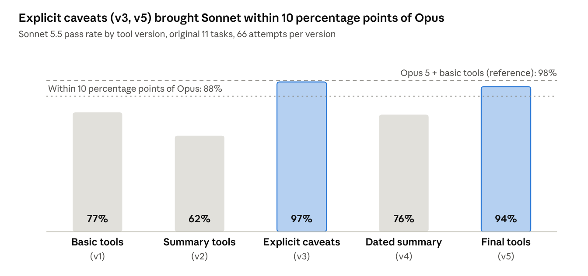
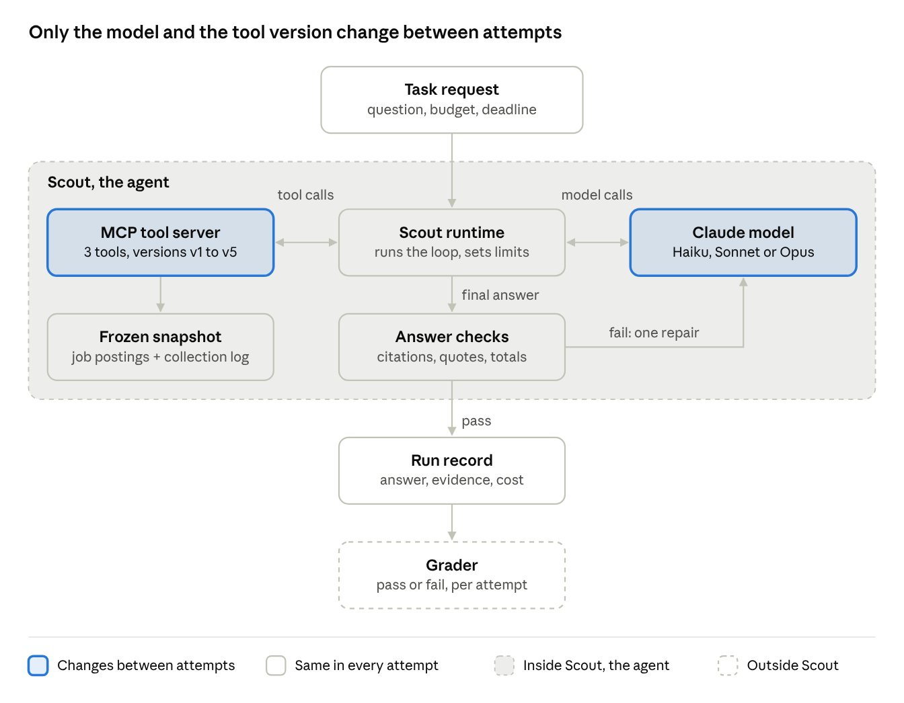

# Scout: Better Tools or a Stronger Model?

[](https://github.com/helenatan/scout-agent/actions/workflows/ci.yml)
[](LICENSE)


Scout is a research agent that answers questions about captured Product Manager job postings. This repository holds
the agent, its tools, the evaluation harness and every graded result from a study of one question:

**Can better tools make a cheaper Claude model reliable enough for the job?**

On ten fresh research tasks, each attempted three times, Sonnet 5.5 and Opus 5 using the final tools reached the same
pass rate: 80% under the grader frozen before the run, and 93% after fixing two grader bugs. Sonnet's estimated
cost per attempt was about a quarter of Opus's. An earlier tool redesign had made Sonnet worse, and working out why
produced the final tools.



## Findings

| Setup | Original 11 tasks | Fresh 10 tasks (original / corrected grader) | Cost per attempt |
|---|---|---|---|
| Opus 5 + basic tools (v1), the reference | 98% (43/44) | 67% / 77% | $0.187 to $0.201 |
| Sonnet 5.5 + basic tools (v1) | 77% (51/66) | | $0.042 |
| Sonnet 5.5 + summary tools (v2) | 62% (41/66) | | $0.047 |
| Sonnet 5.5 + final tools (v5) | 94% (62/66) | 80% / 93% | $0.054 to $0.057 |
| Opus 5 + final tools (v5) | | 80% / 93% | $0.225 |
| Haiku 4.5, best tuned version, held-out tasks | 28% (10/36) | | $0.049 |

- **Tools fixed facts, not judgment.** About half of Haiku's held-out failures in its best version were judgment errors,
  and no tool change moved them. Tuning raised Haiku's development score from 27% to 89% while held-out scores stayed
  between 28% and 33%.
- **A tool redesign can help one model and hurt another.** The summary tools (v2) cost Sonnet 15 percentage points and
  Opus nothing: Sonnet trusted a summary that looked complete and stopped checking the collection record.
- **With the same tools, the models tied.** On fresh tasks, Opus with the final tools matched Sonnet with the final
  tools at about four times the cost. Moving Opus from basic to final tools added 13 to 17 percentage points.

Full tables, failure analysis and caveats: [docs/results.md](docs/results.md).
Every number above is recomputed from [results/attempts.csv](results/attempts.csv) by `python scripts/verify_results.py`.

## How Scout works



The model never touches the data. It works through three tools served over a local
[MCP](https://modelcontextprotocol.io) server: `search_job_postings`, `get_job_posting` and `get_dataset_context`.
The Scout runtime runs the model loop under a budget and deadline, gives every tool result an evidence ID, and checks
the final answer (cited evidence was delivered, quotes are verbatim, arithmetic adds up, required pages were read)
before accepting it, with one repair allowed. Only the model and the tool version change between attempts.

The five tool versions keep the same three tool names and schemas and differ only in what each result carries:
basic tools (v1), summary tools (v2), explicit caveats (v3), dated summary (v4) and final tools (v5).
See [docs/tool-versions.md](docs/tool-versions.md), and [docs/architecture.md](docs/architecture.md) for the
component, sequence, state and evaluation diagrams.

## Quick start

No API key is needed. The demo uses a fictional three-posting snapshot and a scripted model, so it exercises the
software, not model capability.

```bash
python3.13 -m venv .venv
.venv/bin/pip install -r requirements.lock
.venv/bin/python scripts/create_demo_data.py
.venv/bin/python -m pytest tests -q
.venv/bin/python scripts/verify_results.py
SCOUT_PROVIDER=fake .venv/bin/uvicorn scout.service.api:app --port 8000
```

Then open http://127.0.0.1:8000/ui/index.html and use snapshot `pai-2026-08`. Tests that assert numbers from the
original snapshot are skipped automatically on the demo data (listed in `tests/real_data_tests.txt`).

## Reproducing the study

| Level | What you can do | Needs |
|---|---|---|
| 1. Run Scout | Start the service, call the tools in every version, run the test suite | Nothing beyond the quick start |
| 2. Verify the results | Recompute every published number from the per-attempt results | Nothing beyond the quick start |
| 3. Re-run the study | Run any model and tool version on your own snapshot, write tasks, grade them | A Claude subscription or API key, your own data |

The original snapshot and the answer keys are not distributed: they contain job posting text owned by employers and
job boards. [docs/reproduce.md](docs/reproduce.md) gives the exact commands for each level, the database schema
Scout expects, and what an exact re-run would need.

## Repository layout

| Path | Contents |
|---|---|
| `scout/service/` | HTTP API, run engine, budget, evidence store, answer checks, Claude Code and API providers |
| `scout/tools/` | The three data tools, the MCP server, and the tool versions (`pai_tools.py` holds v1 and v2; `tuned.py`, `dated.py`, `v5.py` hold v3 to v5) |
| `scout/ui/` | Local web UI for one run and for comparing saved results |
| `eval/run_original_suite.py` | Run one model and tool version on the original 11 tasks, then grade with grader v3 |
| `eval/run_matrix.py` | General runner used for the fresh tasks and the final evaluation |
| `eval/graders/original_v3/` | Deterministic grader for the original suite (frozen, hash-checked) |
| `eval/tasks/final/`, `eval/tasks/fresh-v1/` | Task prompts, the fresh suite's two-part grader, freeze record and decisions |
| `results/` | One row per graded attempt (pass/fail, cost, time, tokens; no answer text) and its provenance |
| `scripts/` | Demo data, result verification, and the export script that produced `results/` |
| `docs/` | Results, reproduction guide, tool versions, architecture diagrams, figures |
| `site/` | Static findings viewer for the September 27 evaluation; without the private data file it shows labeled sample data |
| `tests/` | Unit and integration tests, runnable without an API key |

## Limits

Eleven original tasks and ten fresh ones, three attempts each, all research over one snapshot of job postings.
Sonnet's lead over Opus with basic tools on the fresh tasks is not statistically significant; "at least as good, at
about a quarter of the cost per attempt" is the supported claim. All attempts ran through headless Claude Code on a
subscription, so costs are list rates applied to reported tokens, not bills. A 50,000-token input limit applied to every
attempt. See [docs/results.md](docs/results.md#limits).

## Citation

If you use this work, cite it with the metadata in [CITATION.cff](CITATION.cff).

## License

Code and documentation are released under the [MIT License](LICENSE). The study's snapshot of job postings is not
part of this repository.
