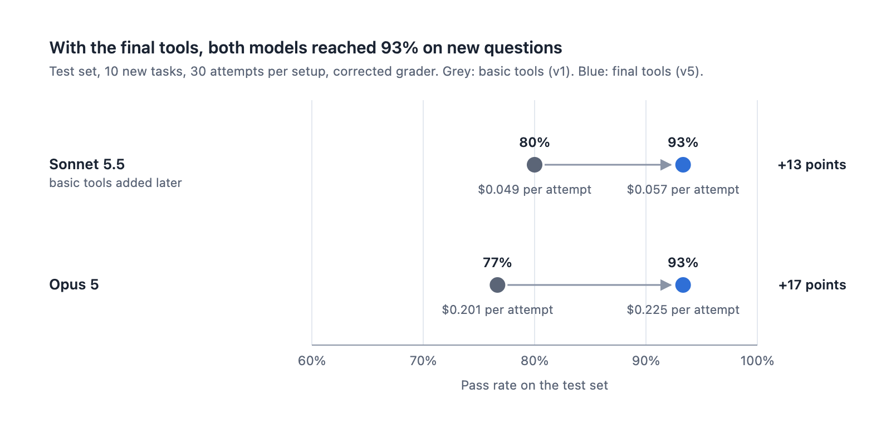
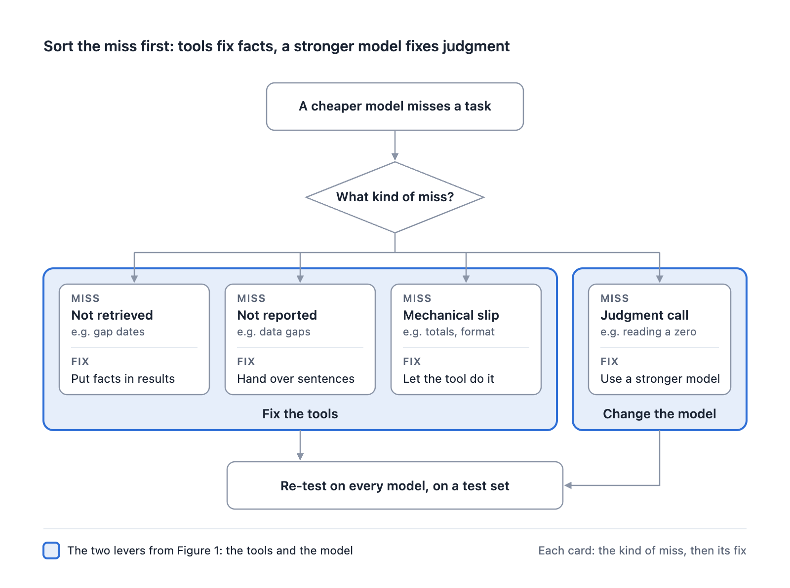

# Scout: Can better tools make a cheaper AI model reliable enough for the job?

[](https://github.com/helenatan/scout-agent/actions/workflows/ci.yml)
[](LICENSE)


I built Scout, a research agent that answers questions about Product Manager (PM) job postings, to test a practical
question: how much can better tools improve a cheaper model? This repository holds the agent, its three tools in five
versions, the evaluation harness and every graded attempt.

**Read the study:** [the write-up](https://helenatan.substack.com/p/can-better-tools-make-a-cheaper-ai) ·
[the interactive version](https://scout-agent-study.vercel.app) ·
[How Scout Works](https://claude.ai/artifact/FhBRECQQofvJQRRRSevtdL)

I tested three Claude models with five versions of Scout's tools. What I found:

- **Better tools let the cheaper model clear the bar.** On a test set of 10 new questions, Sonnet 5.5 with the final
  tools passed more often than Opus 5 with the basic tools (93% against 77%), at 28% of the cost per attempt ($0.057
  against $0.201). Then I gave both models the final tools. They reached the same pass rate, 93%, and Sonnet still cost
  about a quarter as much ($0.057 against $0.225).
- **Tools can hand a model facts; judgment needs a stronger model.** Even after tuning, Haiku 4.5, the cheapest model,
  passed only about 30% of the tasks it was not tuned against. About half of its failures were judgment errors that no
  tool change fixed.
- **The same tool change can hurt one model and leave another untouched.** My first tool redesign lowered Sonnet's pass
  rate from 77% to 62%, while Opus was unaffected. Working out why led to the final tools.



## Findings

A task is one research question with a known answer, and an attempt is one try at it; every setup tried every task three
times. I used two task sets and never pool them. The **tuning set** (11 tasks) is where I studied failures and improved
the tools. The **test set** (10 new tasks) was written and frozen after all the tuning and never tuned against; the
headline numbers come from it. The bar, set before any attempt: a cheaper setup counts as a yes if its pass rate is within
10 percentage points of Opus 5 with basic tools, at a lower cost per attempt.

| Setup | Tuning set, 11 tasks | Test set, 10 new tasks | Cost per attempt (tuning / test) |
|---|---|---|---|
| Opus 5 + basic tools (v1), the reference | 98% (43/44) | 77% (23/30) | $0.187 / $0.201 |
| Sonnet 5.5 + basic tools (v1) | 77% (51/66) | 80% (24/30), added later, 1 pending | $0.042 / $0.049 |
| Sonnet 5.5 + summary tools (v2) | 62% (41/66) | | $0.047 |
| Sonnet 5.5 + explicit caveats (v3) | 97% (64/66) | | $0.054 |
| Sonnet 5.5 + dated summary (v4) | 76% (50/66) | | $0.051 |
| **Sonnet 5.5 + final tools (v5)** | **94% (62/66)** | **93% (28/30)** | **$0.054 / $0.057** |
| Opus 5 + final tools (v5) | | 93% (28/30) | $0.225 |
| Haiku 4.5 + explicit caveats (v3) + self-check, held-out tasks | 28% (10/36) | | $0.049 |

Test-set numbers use the corrected grader. I froze the grader before the run and afterwards found two bugs in it (it
missed quotes stored in one part of an answer, and could not read counts written as "1/1"). Under the original grader the
test set reads 67%, 77%, 80% and 80% for the four rows above, and every comparison points the same way.

- **#1: Tuning Haiku showed which failures tools can fix.** Development scores climbed from 27% to 89% while every tuned
  version landed between 28% and 33% on held-out tasks. Only the first change held up. About half of the remaining
  failures were judgment errors, such as reading zero captured postings as proof a company was not hiring.
- **#2: My first tool redesign made Sonnet worse.** The summary tools (v2) added a one-line gap note to each search
  result. Opus kept checking the full collection record; Sonnet treated the note as enough, looked up the record for 49% of
  time windows instead of 73%, and in most of its new failures never saw the date of the gap.
- **#3: Testing each problem with its own tool version led to the final tools.** Gap sentences ready to copy (v3) took
  Sonnet to 97%; gap dates in each result (v4) only restored 76%. The final tools (v5) do both, plus counts per source
  and named duplicate groups: 94% on the tuning set, within 4 points of Opus at 29% of its cost per attempt.
- **#4: On new questions, Sonnet cleared the bar at 28% of the cost.** With the final tools, Sonnet passed 93% against
  77% for Opus with basic tools. Opus with the final tools also passed 93%, at 3.9 times Sonnet's cost per attempt. A
  setup added later, Sonnet with basic tools, passed 80% (90% read by hand), so on the test set the final tools helped
  Opus (+17 points) more than Sonnet (+13 points).

Full tables, failure analysis and caveats: [docs/results.md](docs/results.md).
Every pass count and cost above is recomputed from [results/attempts.csv](results/attempts.csv) by
`python scripts/verify_results.py`; the hand readings and the run-trace figures (49%, 73%) are explained in
[docs/results.md](docs/results.md).

### How I would choose a model and tools next time



Set the bar with the expensive model first. Keep a tuning set and a separate test set, and run the cheaper model with the
starting tools on the test set too. Sort each failure before choosing a lever: a fact never found, a fact found but left
out, or a slip on a count or format is a tools fix; the right facts and the wrong conclusion call for a stronger model.
Test every tool change on every model. Among the setups that clear the bar, rank by cost per passing answer.

## How Scout works


The model never touches the data. It works through three tools served over a local
[MCP](https://modelcontextprotocol.io) server: `search_job_postings`, `get_job_posting` and `get_dataset_context`.
The Scout runtime runs the model loop under a budget and deadline, gives every tool result an evidence ID, and checks
the final answer (cited evidence was delivered, quotes are verbatim, arithmetic adds up, required pages were read)
before accepting it, with one repair allowed. Only the model and the tool version change between attempts.

The five tool versions keep the same three tool names and schemas and differ only in what each result carries:
basic tools (v1), summary tools (v2), explicit caveats (v3), dated summary (v4) and final tools (v5).
See [docs/tool-versions.md](docs/tool-versions.md) for one request's real response in each version,
[How Scout Works](https://claude.ai/artifact/FhBRECQQofvJQRRRSevtdL) for the full walkthrough, and
[docs/architecture.md](docs/architecture.md) for the
five parts of a run, a step-by-step sequence, how runs end, and how an evaluation works.

## Quick start

No API key is needed. The demo uses a fictional three-posting snapshot and a scripted model, so it exercises the
software, not model capability.

```bash
python3.13 -m venv .venv
.venv/bin/pip install -r requirements.lock
.venv/bin/python scripts/create_demo_data.py
.venv/bin/python -m pytest tests -q
.venv/bin/python scripts/verify_results.py
SCOUT_PROVIDER=fake .venv/bin/uvicorn scout.service.api:app --port 8000
```

Then open http://127.0.0.1:8000/ui/index.html and use snapshot `pai-2026-08`. Tests that assert numbers from the
original snapshot are skipped automatically on the demo data (listed in `tests/real_data_tests.txt`).

## Reproducing the study

| Level | What you can do | Needs |
|---|---|---|
| 1. Run Scout | Start the service, call the tools in every version, run the test suite | Nothing beyond the quick start |
| 2. Verify the results | Recompute every published number from the per-attempt results | Nothing beyond the quick start |
| 3. Re-run the study | Run any model and tool version on your own snapshot, write tasks, grade them | A Claude subscription or API key, your own data |

The original snapshot and the answer keys are not distributed: they contain job posting text owned by employers and
job boards. [docs/reproduce.md](docs/reproduce.md) gives the exact commands for each level, the database schema
Scout expects, and what an exact re-run would need.

## Repository layout

| Path | Contents |
|---|---|
| `scout/service/` | HTTP API, run engine, budget, evidence store, answer checks, Claude Code and API providers |
| `scout/tools/` | The three data tools, the MCP server, and the tool versions (`pai_tools.py` holds v1 and v2; `tuned.py`, `dated.py`, `v5.py` hold v3 to v5) |
| `scout/ui/` | Local web UI for one run and for comparing saved results |
| `eval/run_original_suite.py` | Run one model and tool version on the tuning set (original 11 tasks), then grade with grader v3 |
| `eval/run_matrix.py` | General runner used for the test set |
| `eval/graders/original_v3/` | Deterministic grader for the tuning set (frozen, hash-checked) |
| `eval/tasks/final/`, `eval/tasks/fresh-v1/` | Task prompts for the tuning set (`final/`) and the test set (`fresh-v1/`), plus the test set's two-part grader, freeze record and decisions |
| `results/` | One row per graded attempt (pass/fail, cost, latency, tokens; no answer text) and its provenance |
| `scripts/` | Demo data, result verification, and the export script that produced `results/` |
| `docs/` | Results, reproduction guide, tool versions, architecture diagrams, figures |
| `tests/` | Unit and integration tests, runnable without an API key |

## Limits

- **A small sample.** The test set has 10 tasks, tried three times each. A gap of 93% against 77% on 30 attempts each is
  not enough to call Sonnet with the final tools better than Opus with basic tools, so "at least as good" is the claim the
  data supports. The tuning set has 11 tasks.
- **Estimated costs.** Every attempt ran on a Claude subscription through headless Claude Code, so costs are list prices
  applied to the tokens each attempt used, not a real bill.
- **An input limit.** Every attempt was capped at 50,000 input tokens per request. On the test set, the cap cost Opus with
  basic tools one task and Sonnet with basic tools one attempt.
- **One pending attempt.** One Sonnet with basic tools attempt on the test set awaits human review because the two judge
  models disagreed; it counts as not passed.

See [docs/results.md](docs/results.md#limits).

## Citation

If you use this work, cite it with the metadata in [CITATION.cff](CITATION.cff).

## License

Code and documentation are released under the [MIT License](LICENSE). The study's snapshot of job postings is not
part of this repository.
