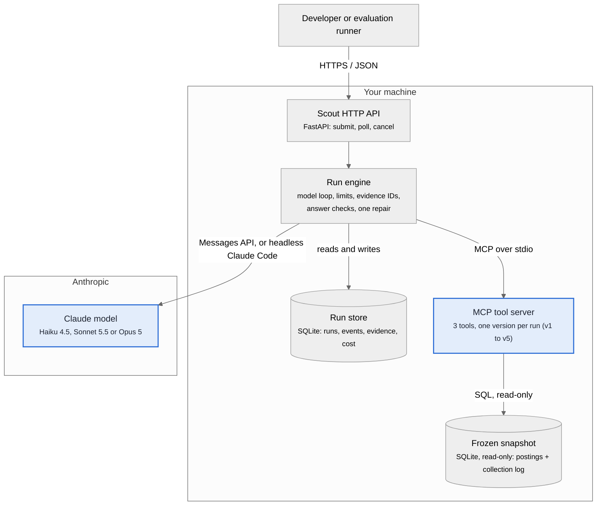
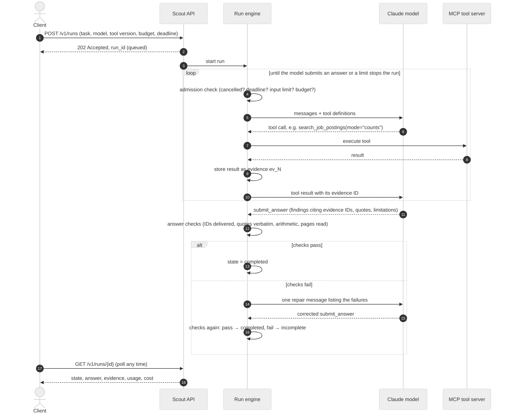
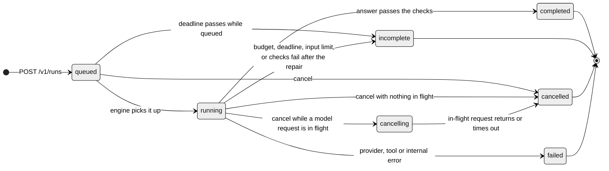
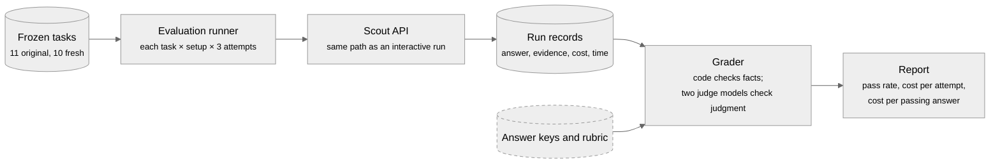

# How Scout works

Scout is a research agent that answers questions about captured Product Manager job postings. A Claude model does the reasoning, three data tools fetch and compute facts, and the Scout runtime runs the loop, enforces limits and checks every answer before accepting it. The four views below use the standard notations for this kind of system; GitHub renders them from the Mermaid source in this file.

## 1 · What runs where

*Component diagram (C4 container level): boxes are running parts, arrows are calls, labels name the protocol.*

**How to read it.** Blue boxes are the two parts the study varies: the Claude model and the tool version. Everything else is the same in every attempt.
- The model never queries the database. It asks for tools; the run engine executes them through the MCP server and gives each result an evidence ID.
- The engine talks to Claude in one of two ways: the Messages API (billed per token) or a headless Claude Code session, which the study used. On the Claude Code path, the CLI runs the turn loop and reaches Scout's tools through a small MCP bridge; Scout still executes the tools, records evidence, checks the answer and enforces the limits.

## 2 · One run, in order

*Sequence diagram: time runs downward; solid arrows are calls, dashed arrows are replies; boxes mark loops and alternatives.*

**How to read it.** Steps 4 to 10 repeat once per tool call; in the study, attempts averaged about 6 to 9 tool calls. Before every model request, the admission check can stop the run: if it is cancelled, out of time, over the 50,000-token input limit, or out of budget, no request is sent. The answer checks never see the answer key; they catch mechanical problems (a cited result that was never delivered, a quote that is not verbatim, totals that do not add up, a list cited with pages unread). Whether the answer is *correct* is decided later, by the grader.

## 3 · Run states

*State diagram: rounded boxes are states a run can be in; arrows are the events that move it.*

**How to read it.** Four end states, each with a machine-readable reason. `completed` means the runtime checks passed, not that the answer is right. `incomplete` carries the reason it stopped: `budget_exhausted`, `deadline_exceeded`, `validation_failed` (checks failed again after the one repair) or `stalled_execution` (for example, a request over the input limit). Cancelling never aborts a request already sent, so its cost is still recorded.

## 4 · How an evaluation is run and graded

*Data-flow diagram: boxes are steps, cylinders are stored data, the dashed box is private.*

**How to read it.** Evaluation uses the same API and engine as an interactive question, so the score describes the product as it runs. Tasks, answer keys and grader are frozen before the first attempt. The answer keys are never visible to the model, the tools or the runtime checks. The grader has two parts: code checks facts with one right value (counts, posting IDs, labels, verbatim quotes), and two judge models answer yes or no on judgment points; both must say yes, and a disagreement goes to a person.

## Glossary

- **MCP:** Model Context Protocol, the open standard for connecting a model to tools and data. Scout's three tools run in a local MCP server, one process per run.
- **Tool version:** What each tool result carries. All five versions keep the same tool names and inputs: basic tools (v1), summary tools (v2), explicit caveats (v3), dated summary (v4), final tools (v5).
- **Evidence ID:** A label (`ev_1`, `ev_2`, ...) the engine gives each tool result in delivery order. Answers must cite these IDs, so every claim traces back to what the model actually saw.
- **Admission check:** The permission check before each model request: the run is still active, not cancelled, within its deadline, under the input limit, and the cost fits the remaining budget.
- **Repair:** One chance to fix an answer that failed the runtime checks, under the same budget and deadline.
- **Attempt:** One run of one task with one model and tool version. Every setup tried every task three times.

Code: the HTTP API is `scout/service/api.py`, the run engine `scout/service/engine.py`, the answer checks `scout/service/validators.py`, the Claude Code path `scout/service/claude_code.py` and `scout/tools/cc_bridge.py`, and the tools `scout/tools/`.
