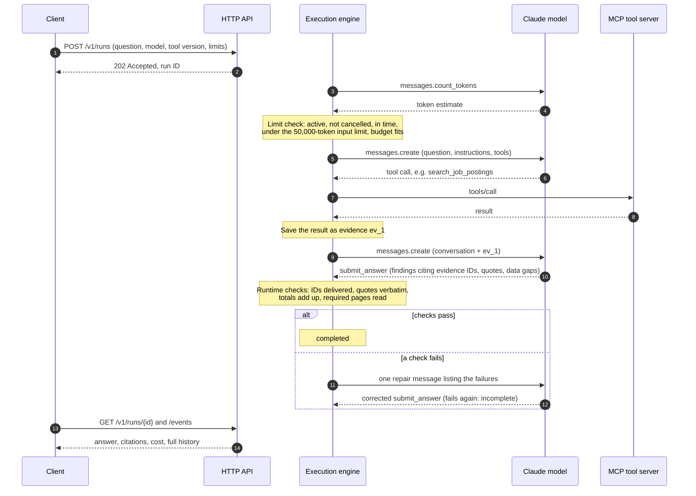

# How Scout works

Scout is a research agent that answers questions about captured Product Manager job postings. A Claude model does the
reasoning, three data tools fetch and compute facts, and Scout's execution engine runs the loop, enforces limits and
checks every answer before accepting it. Every view below uses the same five lanes.

## 1 · What runs where

| Lane | Runs on | What it does |
|---|---|---|
| Client | Your machine | The browser UI (`scout/ui/`) or the evaluation runner (`eval/run_matrix.py`). Submits questions and reads results. |
| HTTP API | Your machine | Accepts a run, returns its ID, serves status, answer, evidence and cost (`scout/service/api.py`). |
| Execution engine | Your machine | Runs the model loop, checks limits, gives each tool result an evidence ID, checks the answer, allows one repair (`scout/service/engine.py`, `validators.py`). Writes to the **run store** (SQLite). |
| **Claude model** | Anthropic | Haiku 4.5, Sonnet 5.5 or Opus 5. Decides which tool to call and writes the answer. Never touches the data directly. |
| **MCP tool server** | Your machine | The three data tools in one version per run, v1 to v5 (`scout/tools/`). Reads the **frozen snapshot** (SQLite, read-only). |

The two lanes in bold are what the study changes; everything else is the same in every attempt.

## 2 · One run, step by step

Messages API path. Steps 2 to 4 repeat for each tool call; attempts in the study averaged about 6 to 9.

**The Claude Code path (used in the study)** differs in three places. The engine starts a headless `claude -p` session
with Scout's instructions, and Claude Code reaches Scout's tools through a small MCP bridge (`scout/tools/cc_bridge.py`)
with its own built-in tools switched off. Token counting is not available, so the budget and the input limit are checked
on each request as its usage arrives. Tool calls arrive through the bridge, but the engine still executes them, saves the
evidence and runs the same answer checks.

## 3 · How a run ends

Every run goes `queued` → `running` → one of four end states, saved with a reason code.

| End state | Meaning | Reason codes |
|---|---|---|
| `completed` | The answer passed the runtime checks, first time or after the repair. Correctness is decided later by the grader. | `validated` |
| `incomplete` | Scout stopped the run. | `validation_failed` (checks failed again after the repair), `budget_exhausted`, `deadline_exceeded` (including while queued), `stalled_execution` (a request over the input limit, or repeated tool failures) |
| `cancelled` | Someone cancelled the run. With a model request in flight, it shows `cancelling` until that request returns, and its cost is still recorded. | `cancel_requested` |
| `failed` | The model provider, a tool, or Scout itself broke. | `provider_error`, `tool_error`, `internal_error` |

## 4 · How an evaluation works

An evaluation runs every task under every setup through the same engine as an interactive question, then grades the
saved answers. Numbers below are from the 10 new tasks.

1. **Freeze.** Tasks, answer keys and grader are fixed and hashed before the first attempt (`eval/tasks/fresh-v1/FREEZE.json`). The keys stay private.
2. **Run.** Each task, under each setup, three times, through the HTTP API: 10 tasks × 3 setups × 3 = 90 attempts.
3. **Record.** Each attempt saves its answer, the evidence it saw, its cost and its time.
4. **Grade.** Code checks the facts with one right value; two judge models answer yes or no on the judgment points, both must say yes, and a disagreement goes to a person (`eval/tasks/fresh-v1/grade_fresh.py`).
5. **Report.** Pass rate, cost per attempt, cost per passing answer and latency, per setup ([results.md](results.md)).

The answer keys are never visible to the model, the tools or the runtime checks; only the grader reads them.

## Glossary

- **MCP:** Model Context Protocol, the open standard for connecting a model to tools and data.
- **Tool version:** what each tool result contains. All five versions keep the same tool names and inputs: basic tools (v1), summary tools (v2), explicit caveats (v3), dated summary (v4), final tools (v5). See [tool-versions.md](tool-versions.md).
- **Evidence ID:** a label (`ev_1`, `ev_2`, ...) the engine gives each tool result in delivery order. Answers must cite these IDs.
- **Limit check:** before each model request, the run is still active, not cancelled, within its deadline, under the input limit, and the cost fits the remaining budget.
- **Repair:** one chance to fix an answer that failed the runtime checks, under the same budget and deadline.
- **Attempt:** one run of one task with one model and tool version.
