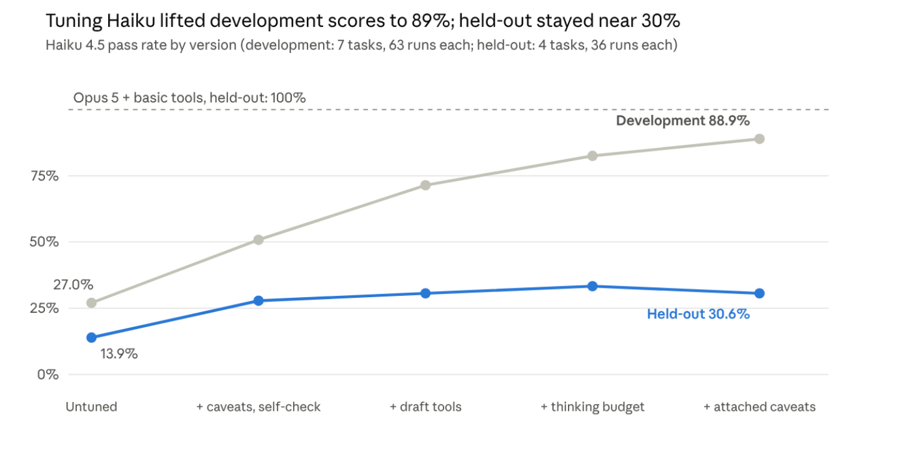

# Results

Every pass count, cost and time in the tables below is recomputed from [`results/attempts.csv`](../results/attempts.csv)
by `python scripts/verify_results.py`, which exits with an error if any number here drifts from the data.
Figures marked *(from run traces)* come from the saved run records, which are not published because they contain
posting text.

## Design

- **Workload.** Research questions over a frozen snapshot of Product Manager postings captured daily from JSearch,
  Greenhouse and Ashby starting May 18, 2026. Questions point at monthly (`pai-2026-07`) or weekly (`pai-w-2026-07-20`)
  windows. A published identity rule (stored company name plus lower-cased, trimmed title) defines one distinct
  opening, so every count has one right answer.
- **Levers.** Model (Haiku 4.5, Sonnet 5.5, Opus 5) and tool version (v1 to v5, see [tool-versions.md](tool-versions.md)).
  Prompt, tasks, runtime limits and grading stay fixed.
- **Terms.** A *task* is one question with a known answer; an *attempt* is one try at it; every setup tried every task
  three times. The *grader* scores each attempt against the answer key; the *pass rate* is the share of attempts it
  passed. Differences are in percentage points.
- **What counts as a pass.** Every required fact is right and the answer reports the data limits that change its
  conclusion (for example, a day a source returned zero records). A wording difference alone should not fail an answer;
  grader checks that did were treated as grader bugs.
- **The bar, set before any attempt.** A cheaper setup counts as a yes if its pass rate is within 10 percentage points of
  Opus 5 with basic tools, at a lower cost per attempt.
- **Execution.** All attempts ran through headless Claude Code on a subscription (`SCOUT_PROVIDER=claude-code`). Scout
  owned the tools, evidence, answer checks, the one repair and the deadline. Costs are the published list rates
  (per million tokens: Haiku 4.5 $1/$5, Sonnet 5.5 $2/$10, Opus 5 $5/$25; cache write 1.25x, cache read 0.1x) applied
  to the tokens each attempt reported. Every attempt had a 50,000-token input limit per model request.

## Original 11 tasks

Seven development tasks (R1 R3 E1 E3 C1 C2 I2) and four held-out tasks (R2 E2 C3 I1), graded by the deterministic
[grader v3](../eval/graders/original_v3/) (no model calls).

| Model and tools | Passed | Pass rate | Cost per attempt |
|---|---|---|---|
| Opus 5 + basic tools (v1), reference | 43/44 | 98% | $0.187 |
| Opus 5 + summary tools (v2) | 33/33 | 100% | $0.193 |
| Sonnet 5.5 + basic tools (v1) | 51/66 | 77% | $0.042 |
| Sonnet 5.5 + summary tools (v2) | 41/66 | 62% | $0.047 |
| Sonnet 5.5 + explicit caveats (v3) | 64/66 | 97% | $0.054 |
| Sonnet 5.5 + dated summary (v4) | 50/66 | 76% | $0.051 |
| Sonnet 5.5 + final tools (v5) | 62/66 | 94% | $0.054 |
| Haiku 4.5 + summary tools (v2) | 27/132 | 20% | $0.033 |
| Haiku 4.5 + explicit caveats (v3) + self-check (V0) | 52/135 | 39% | $0.049 |

The Opus reference pools the 33 attempts of the September 27 final evaluation with 11 later attempts. Haiku + summary tools pools the final
evaluation's 33 attempts with 99 round-4 tuning attempts; the V0 row is round 4 only (development, held-out and the
held-out re-measure).

### Why the summary tools made Sonnet worse

Ten of Sonnet's first 13 failures with v2 left out a data gap: a missing collection day, a day a source reported success
but fetched zero records, or the first collection run, when the job boards loaded their whole backlog. How often each
model looked up the collection record for the windows it used *(from run traces)*:

| Model and tools | Windows checked | Attempts that check coverage first |
|---|---|---|
| Opus 5, basic | 78% | 70% |
| Opus 5, summary | 78% | 73% |
| Sonnet 5.5, basic | 73% | 72% |
| Sonnet 5.5, summary | 49% | 37% |

The summary looked complete, so Sonnet skipped the call that held the dates. The two follow-up versions tested the two
possible causes: the dated summary (v4) put the dates in view and only restored Sonnet's v1 level, while explicit caveat
sentences (v3) took it to 97%. Sonnet copied 90% of the caveat sentences it received *(from run traces)*.

### Why v5 and not v3

v3 scored two attempts higher, which is within noise on 66 attempts. Its two misses were real counting errors (two
duplicate groups covering eight records, not named); v5 names the groups, returns counts per source, and halved the
tool calls on the comparison tasks *(from run traces)*. v5's four misses were strict wording checks on held-out tasks;
three of the four answers were correct on a hand reading. v5 was built after reading failures on all 11 tasks, so the
fresh suite below is its real test.

## Haiku tuning

Claude Code was given one goal: raise Haiku's pass rate. Tasks were split into development tasks the tuning could score
against and held-out tasks used only to check finished versions. Before comparing versions, a rule was set: a change
that widened the development/held-out gap beyond run-to-run noise counted as overfitting.

| Variant | Development (63 attempts) | Held-out (36 attempts) |
|---|---|---|
| C: summary tools (v2), untuned | 17/63 (27.0%) | 5/36 (13.9%) |
| V0: explicit caveats (v3) + self-check | 32/63 (50.8%) | 10/36 (27.8%), re-measured 10/36 |
| V1: + drafting tools | 45/63 (71.4%) | 11/36 (30.6%) |
| V2: + thinking budget | 52/63 (82.5%) | 12/36 (33.3%) |
| V3: + attached caveats | 56/63 (88.9%) | 11/36 (30.6%) |

V1 to V3 were flagged as overfitting; V0 is the honest result. In V0's held-out failures, about half were judgment
errors (reading a zero as "no openings", accepting a claim that should have been rejected) that no tool change moved
*(from run traces)*.

## Fresh tasks

The original tasks were spent once v5 was built after reading their failures. An agent wrote ten new tasks without
access to the tools, the runs or the reports; the owner reviewed every answer key and decided the judgment calls
([DECISIONS.md](../eval/tasks/fresh-v1/DECISIONS.md)): where a careful reader could go either way, an answer passes if it
states the choice it made. Tasks, keys and grader were frozen ([FREEZE.json](../eval/tasks/fresh-v1/FREEZE.json))
before any attempt.

The grader has two parts: code checks facts with one right value (counts, posting ids, labels, verbatim quotes), and two
judge models (Opus 5.5 and Fable 5.1) answer yes/no rubric items on the judgment points; both must say yes, and a
disagreement goes to a person.

| Model and tools | Original grader | Corrected grader | Cost per attempt | Median latency | Cost per passing answer (original / corrected) |
|---|---|---|---|---|---|
| Sonnet 5.5 + final tools (v5) | 24/30 (80%) | 28/30 (93%) | $0.057 | 38 s | $0.071 / $0.061 |
| Opus 5 + basic tools (v1) | 20/30 (67%) | 23/30 (77%) | $0.201 | 59 s | $0.302 / $0.263 |
| Opus 5 + final tools (v5) | 24/30 (80%) | 28/30 (93%) | $0.225 | 42 s | $0.282 / $0.241 |

**Original and corrected grades.** The original grader is the one frozen before the run. Afterwards two bugs were found:
it missed quotes stored in the structured part of an answer, and it could not read per-source counts written as `1/1`.
Fixing them raised both models' scores, every comparison points the same way under both, and the corrected grader
matches a hand reading of every answer in the Sonnet + v5 and Opus + v1 arms. A third known issue (a negated section phrase counted as a label vote) is
unfixed and cost Opus + v5 one attempt. The judges never disagreed.

**What failed.** Opus with basic tools lost two whole tasks: on F-C2 it cited a list without reading every page and
still failed after the one repair; on F-I1 it read full postings until a request passed the 50,000-token input limit.
The final tools fixed both. With the final tools, each model failed 2 of 30 attempts under the corrected grader: two
malformed final answers, one grader misreading, and one real omission (a missing verbatim quote). Neither model came
near the input limit (peak requests about 35,000 tokens for Sonnet, 44,000 for Opus *(from run traces)*).

**Cost per passing answer.** The final tools made each Opus attempt about 12% more expensive but each passing answer
about 8% cheaper, because fewer attempts failed.

## Final evaluation, September 27

The planned final evaluation compared four configurations on the original 11 tasks: Haiku 4.5 and Opus 5, each with
basic and summary tools, 132 attempts in all. Its official grading used two independent reviewer agents plus human
review of disagreements and a predeclared sample; 40 items still await human review, so those grades are provisional
and pending items count as neither pass nor fail. The same attempts graded with grader v3 are part of the tables above.

| Config | Model and tools | Confirmed passes | Pending human review |
|---|---|---|---|
| A | Haiku 4.5 + basic tools | 0/33 | 18 |
| B | Opus 5 + basic tools | 29/33 | 4 |
| C | Haiku 4.5 + summary tools | 2/33 | 14 |
| D | Opus 5 + summary tools | 29/33 | 4 |

Details and disclosures: [final-results.md](final-results.md).

## Limits

- **Small task sets.** Eleven original tasks and ten fresh ones, three attempts each. On the fresh tasks, Sonnet's lead
  over Opus with basic tools is not statistically significant (official 95% intervals about 63-90% vs 49-81%).
  "At least as good, at about a quarter of the cost per attempt" is the claim the data supports.
- **One domain.** Every task is research over one snapshot of job postings. Tasks with more open-ended judgment may
  favor a larger model.
- **Notional costs.** Subscription execution; list rates applied to reported tokens.
- **Runtime limits.** The 50,000-token input limit applied to every model and cost Opus with basic tools one fresh task.
- **Not compared.** Opus 5.5, the current Opus, is cheaper than Opus 5 ($4/$20 per million tokens), so the cost gap
  against it would be smaller.
- **Shared records.** Some postings appear in more than one task, so task outcomes are not fully independent.
